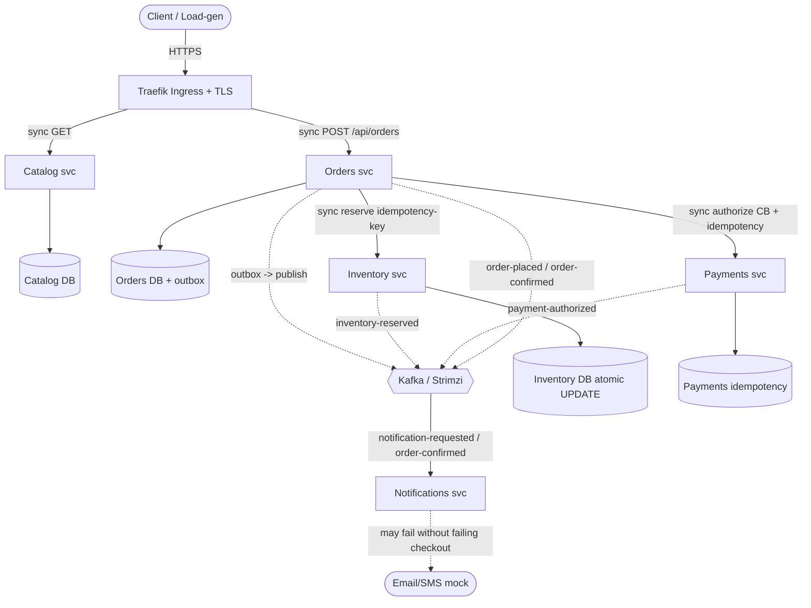

# EuroTransit — Design & consistency justification (g03)

> Team-owned. The agent helped draft and explain; every decision below is one we can defend
> at the oral. This is the canonical design doc; the shared team document mirrors it.

## 1. Architecture

## 2. Money path (critical path)

1. **Place order (sync, returns fast):** `POST /api/orders` → Orders persists the order
   `PENDING` and writes `order-placed` to the **outbox** in the *same* DB transaction; returns
   **202 Accepted** with `orderId`.
2. **Publish (outbox → Kafka):** a coroutine relay publishes `order-placed` (at-least-once).
3. **Reserve (async pipeline → sync call):** Orders consumes `order-placed` and calls
   `Inventory.reserve` synchronously with an idempotency key. Atomic conditional UPDATE → on
   success `RESERVED` + `inventory-reserved`; if sold out → compensate, order `REJECTED`.
4. **Authorize (sync, protected):** Orders calls `Payments.authorize` behind circuit breaker +
   timeout + retry(backoff+jitter) + bulkhead, with idempotency key. Success → `payment-authorized`;
   breaker open/timeout → fallback (no unbounded hang).
5. **Confirm:** order `CONFIRMED` → `order-confirmed` + `notification-requested`.
6. **Notify (fully async, degrades):** Notifications consumes and sends; if down, checkout has
   already succeeded.

**Key subtlety:** the sync calls to Inventory/Payments happen *inside* the async pipeline —
the HTTP request returns immediately, but later stages make synchronous calls where a decision
is needed *now*.

## 3. Sync vs async boundaries

| Boundary | Mode | Why |
|---|---|---|
| client → gateway → Catalog | sync | read, tolerant of staleness |
| client → gateway → Orders (place) | sync, returns 202 | user needs an immediate ack, not the full result |
| Orders → Inventory (reserve) | sync | a reservation decision must be made now |
| Orders → Payments (authorize) | sync | an authorization decision must be made now |
| pipeline stages / all eventing | async (Kafka) | decouple, absorb bursts, survive downstream blips |
| Notifications | async | must fail without failing checkout |

## 4. Design decisions (summary — full rationale owned by team)

1. **Database-per-service** (ownership, not just SPOF). Orders (2 instances) and Inventory
   (3 instances) are the HA, correctness-critical stores. Payments gets a small **dedicated
   single-instance** cluster *(team decision, 2026-06-09)*: it is on the money path but not
   contended — "no double-charge" is enforced by the idempotency table regardless of
   availability, and unavailability is contained by the Orders circuit breaker + fallback.
   Kept as a dedicated Cluster CR (not a logical DB inside another cluster) because CNPG's
   `initdb` bootstrap + auto-generated `-app` secret work per-cluster; a second database in a
   shared cluster needs Database CRs + managed roles + hand-made secrets and couples failure
   domains. Catalog single (staleness-tolerant). No service reads another's DB.
2. **No dedicated auth service** (not required; would be scope creep). Optional gateway-level
   token/forwardAuth only.
3. **Orchestrated saga** (Orders coordinates; stages Kafka-driven; compensations on failure).
4. **Transactional outbox** to avoid the dual-write problem → at-least-once → idempotent consumers.
5. **Inventory consistency = CP / PACELC PC-EC**: prefer rejecting a reservation over overselling
   in a partition; accept slightly higher latency for consistency without a partition.
   Implemented as an atomic conditional `UPDATE ... WHERE available >= qty` (single-row,
   transactional) + a reservation state machine (`RESERVED → CONFIRMED | RELEASED/EXPIRED`).
6. **Idempotency** on the money path: key = `orderId`. Inventory dedup `(orderId, productId)`;
   Payments dedup by key with persisted result. **Dedup-insert and decrement in one transaction.**
7. **Resilience4j — circuit breaker (Phase 2 #1, IMPLEMENTED 2026-06-25).** Orders→Payments is wrapped in a
   circuit breaker applied **programmatically** through the injected `CircuitBreakerRegistry`
   (`HttpPaymentsGateway`), **not** the `@CircuitBreaker` annotation: the `-spring-boot3` starter's AOP aspect
   is not guaranteed to weave on Boot 4 (agent-log #2), whereas the registry bean is verified to bind, so
   decorating through it is deterministic (proven end-to-end by `PaymentsGatewayBreakerIntegrationTest`).
   Policy (`instances.payments`): COUNT window 10, min 5 calls, **open at >50% failures OR >50% slow calls
   (slow = >2s)** — the prof's two open criteria (deck 11 s.17); wait-open 10s, 2 half-open probes, auto-transition.
   `ignore-exceptions: HttpClientErrorException` so a 4xx never trips the breaker; a 4xx is instead mapped to a
   terminal DECLINED (a permanent client error must not park forever). A transport fault → fallback `"UNAVAILABLE"`
   → the saga PARKS the order in **`PAYMENT_PENDING`** (it does not reject — the card may be fine — and does not
   propagate). `OrderRecoverySweeper` retries parked orders and **bounds the park by age** (`app.recovery.max-park`
   ≤ inventory hold TTL), rejecting a clearly-expired hold WITHOUT re-authorizing so a card is never charged for a
   restocked hold (since #4 the sweep also voids any live charge before rejecting, and on an unreachable Payments keeps
   the order parked to retry the void rather than abandon it — see decision 7 #4; observable via
   `orders_recovery_total{outcome=void_retry}` / `orders_compensations_total{type=refund}`). The breaker is excluded
   from health (`management.health.circuitbreakers.enabled: false`) — an OPEN breaker is the system working, not
   failing. An **optimistic lock** (`@Version` on `Order` + migration V2) prevents duplicate terminal outbox events
   when the sweep races across pods (the loser rolls back). The thresholds are a team policy decision.

   **Resilience4j — retry + bulkhead + timeout (Phase 2 #2, IMPLEMENTED 2026-06-26).** Both gateways now route every
   remote call through `GatewayResilience` (single source of truth for the policy composition), applied
   **programmatically** like #1 (per-module `Bulkhead`/`CircuitBreaker`/`Retry.decorateCallable`, **not** the
   `@Bulkhead`/`@Retry` annotations — and not the `Decorators` builder, which lives in `resilience4j-all`, a
   non-dependency; the per-module decorators are already on the starter's classpath). **Composition order** =
   `Retry( CircuitBreaker( Bulkhead( call ) ) )` (canonical R4j, retry outermost). **Retry**
   (`instances.{payments,inventory}`): max-attempts 3, 200ms base, exponential ×2 + jitter; `retry-exceptions` =
   **transport only** (`HttpServerErrorException`, `ResourceAccessException`) — never a 4xx / business outcome, never
   `CallNotPermittedException` (breaker OPEN ⇒ fast-fail, no retry storm, slide 45) or `BulkheadFullException`. The
   values are **deliberately shorter than the slide-22 example (1s/2s/4s, cap 30s, max 5)**: the slide's own rule is
   "derive retry/timeout from the end-to-end deadline", and our checkout SLO is e2e p95 ≤ 5s — so the inline retry only
   absorbs up to two transient blips (max-attempts 3 = 1 call + 2 retries), while a sustained outage is handled by breaker → `PAYMENT_PENDING` → recovery sweep
   (the "long retry"). **Bulkhead** (SEMAPHORE, fail-fast `max-wait 0` — no queue, slide 7): separate instances
   `payments` (8) / `inventory` (16) — the separation IS the isolation (a slow Payments exhausts only its own permits,
   deck 11 s.20); a saturated Payments bulkhead → `BulkheadFullException` → mapped to `UNAVAILABLE`/park (controlled
   refusal, observable as `orders_payment_failures_total{outcome=bulkhead_full}` — a DISTINCT outcome from a
   downstream-down/breaker-open `unavailable`), and added to the **breaker's ignore-exceptions** so a local concurrency
   cap never by itself opens the breaker (genuine slowness is already caught by the >2s slow-call rate). **Timeouts** (connect 2s / read 5s,
   unchanged) are the per-call deadline partition of the checkout budget — there is no `docs/slo.md` file yet, so the
   budget is documented here. The breaker stays **Payments-only** (Inventory is the contended resource, not a money
   coordinator; bulkhead + idempotent retry suffice). Proven by `RetryBulkheadConfigTest` (non-default binding +
   retry-exceptions whitelist), `PaymentsRetryTest` (5xx retried, 4xx not), `BulkheadIsolationTest` (saturate Payments
   ⇒ Inventory unaffected), `PaymentsRetryIntegrationTest` (503→503→200 absorbed end-to-end; always-503 → UNAVAILABLE).
   Sizes/attempts are a team policy decision, tunable.

   **Resilience4j — backpressure / load shedding (Phase 2 #3, IMPLEMENTED 2026-06-26).** The synchronous intake
   `POST /api/orders` is rate-limited: over budget it is refused immediately with **HTTP 429 + `Retry-After`**
   instead of being queued ("backpressure is controlled refusal"; "queues just delay the failure", deck 11 s.24/7).
   Applied **programmatically** via `RateLimiterRegistry` in a dedicated edge component `OrdersIntakeRateLimiter`
   (`withPermit{}`) — same Boot-4 rationale as #1/#2 (no `@RateLimiter` AOP). `instances.orders-intake`:
   `limit-for-period 20`, `limit-refresh-period PT1S`, `timeout-duration PT0S` (never queue — shed at once). The
   `Retry-After` value is **derived from the limiter window** (not a magic number). Health indicator disabled
   (`management.health.ratelimiters.enabled: false`) like the breaker — shedding is the system *working*, it must
   not flip readiness. The 429 lives **only at the edge**; internal saga calls are governed by breaker/bulkhead,
   never a 429 (#3.5). Observable as the low-cardinality counter `orders_intake_shed_total`. Proven by
   `OrdersIntakeRateLimiterTest` (within budget → 202; over budget → shed counted → 429 + Retry-After). The
   threshold is a team policy decision, tunable from a load-test baseline.

   **Resilience4j — refund/void compensation (Phase 2 #4, IMPLEMENTED 2026-06-26).** Closes the saga's last gap:
   if the inventory hold expires AFTER `authorize` charged the card, the saga now **voids** the charge before
   rejecting, preserving the invariant *"no charge without a seat"* (decision #3). **Void = an idempotent state
   transition `AUTHORIZED → VOIDED` on the EXISTING `payment_authorizations` aggregate** (`PaymentsService.void`,
   `POST /api/payments/authorizations/{orderId}/void`) — **not** a separate reversal table: it is the real PSP
   semantics (cancel an un-captured authorization), and re-voiding a `VOIDED` row is a replay. *"refund" in the
   metric name denotes this void primitive* (the mock PSP authorizes, never captures, so there is no CAPTURED
   state to refund). **No migration**: `VOIDED` writes into the existing `status VARCHAR(16)` with no CHECK; on
   postgres `ddl-auto: validate` checks the column mapping, not the enum value-set. **No Kafka event** (payment
   events are best-effort/informational with no consumer). The gateway `payments.void` reuses the **same `payments`
   Resilience4j instance** as authorize (breaker+bulkhead+retry — same downstream, idempotent ⇒ retry-safe, slide
   22), with the **same 4-branch fallback** (distinct `bulkhead_full` vs `unavailable`; a void 404 → benign
   `NOT_FOUND`). **Failed-void handling = Option B (team decision):** on `UNAVAILABLE`/`FAILED` the saga does **not**
   go terminal with a live charge — it **parks** (`PAYMENT_PENDING`) so `OrderRecoverySweeper` re-drives the saga and
   **retries the void** until it succeeds. At the `app.recovery.max-park` boundary the sweep is consistent with this:
   it voids, then rejects only when the money state is **resolved** (`VOIDED` = reversed, or `NOT_FOUND`/`DECLINED` =
   no charge ever); if Payments is still unreachable (`UNAVAILABLE`/`FAILED`) it **keeps the order parked and retries
   the void next sweep** rather than abandoning a possibly-live charge (`orders_recovery_total{outcome=void_retry}`).
   *Tradeoff (team decision):* this trades the old bounded-retention guarantee for money-safety — during a sustained
   Payments outage parked orders drain on recovery instead of being force-terminated at max-park. A crash between
   void and reject is absorbed by a `"VOIDED" → reject(RESERVATION_EXPIRED)` branch in the stage-2 dispatch (a
   VOIDED replay = already compensated). Observable via `orders_compensations_total{type="refund"}` (successful
   reversals, counted once via the `replayed` flag) and `payments_voids_total{outcome}`. **Follow-up:** a lost-update guard (`@Version` / conditional
   `UPDATE … WHERE status='AUTHORIZED'`) on the void transition is **deferred** — money-safe today (void has no
   external side-effect, so a concurrent double-void converges to the same `VOIDED` row), and adding `@Version`
   would break the migration-free property; it becomes required only if a real PSP storno side-effect is ever added.
   Proven by `OrderSagaTest` (compensation #5.4, failed-void-parks-then-rejects, VOIDED-replay) and
   `PaymentsServiceTest` (void idempotency, no-op on declined, not-found). The design's first cut (reject-always +
   counter) only OBSERVED the leak; a 3-lens adversarial review caught it — see `agent-log.md` #9.
8. **Tracing:** OpenTelemetry via Micrometer Tracing → OTLP → Tempo/Jaeger; propagate context
   across Kafka headers.
9. **Progressive delivery:** canary via Traefik `TraefikService` (weighted); blue/green via dual
   deployments + routing switch. all-at-once/rolling discussed but not used on the critical path.
10. **No heavyweight frontend:** a thin client / load generator (k6) is enough to demonstrate
    behaviour under load.
11. **Observability decisions** *(team, 2026-06-10)*: **Tempo** as tracing backend
    (Grafana-native, exemplars) behind an **OpenTelemetry Collector** gateway; Micrometer →
    Prometheus via ServiceMonitor/PodMonitor; dashboards = money-path overview, per-service
    RED, infra USE, **Kafka consumer lag** (leading indicator of pipeline latency), CNPG.
    SLIs: ack latency measured at the edge (Traefik) + Orders; end-to-end confirm latency and
    success-rate as **business metrics emitted by Orders** (only it sees the state machine —
    not derivable from HTTP metrics because the flow crosses Kafka). Only multi-window
    burn-rate alerts page. Structured JSON logs with traceId; no mandatory log aggregation
    (Loki = bonus). 100% sampling + exemplars at demo scale. Dashboards provisioned as code
    from this repo. Details: `slo.md` + `platform/observability/README.md`.
12. **Replication posture per database (PACELC made concrete)**: CNPG replicates
    asynchronously by default → a failover can lose the last committed transactions (RPO > 0),
    which would break "never oversell" exactly under chaos #5 (a committed reservation
    vanishes, the counter rolls back, the seat is sold twice — the atomic UPDATE protects
    against concurrency, not against losing committed state). Therefore: **inventory-db =
    synchronous replication** (3 instances, ANY 1, `dataDurability: required`) → RPO=0 always;
    one replica can die without blocking writes; if the primary is partitioned from both
    standbys, writes **block** — consistency over availability, exactly our PC/EC statement.
    **orders-db = synchronous `preferred`** (2 instances) → RPO=0 while healthy, degrades to
    async instead of blocking order intake if the standby disappears (the invariants do not
    live in orders-db). payments-db and catalog-db: single instance (see decision 1).
    Requires CNPG ≥ 1.25.

## 4b. Phase 3 — platform decisions (D-A…D-G; team 2026-06-26, deviations verified on the real cluster 2026-06-28)

Bringing the system onto a real cluster (Azure AKS), reconciled by Argo CD. Labels match `docs/FASE3_*`.

- **D-A — one shared AKS cluster** (`lab_g03_cluster`, RG `lab02_g03_group`, region `spaincentral`); every member
  added as *Cluster Admin*, not one cluster per person — a single cluster keeps more shared student credit for the
  work/demo days instead of burning it in parallel.
- **D-B — `az aks stop` when idle** (deallocate the nodes, do not destroy): the one decision that keeps the project
  inside the budget — running h24 ≈ 8€/day vs cents/day stopped (data persists on disk, restart ~3-5 min).
- **D-C — node pool: 3× `Standard_B2s_v2`** (6 vCPU / 24 GiB). *Deviation from the theoretical 2× `B4ms`*: the
  regional quota is only **6 vCPU** and `B4ms`/`B4s_v2` are unavailable in `spaincentral`, so 3× `B2s_v2` is the
  in-quota fit — covers the ~3.3 vCPU / ~9 GiB of requests with RAM headroom, and 3 nodes are actually better for
  the topology-spread / PDB demos. Caveat (Phase 6): a chaos node-kill leaves 4 vCPU → some pods `Pending`, itself a
  documented finding.
- **D-D — platform installed by hand** (`helm`/`kubectl`, once); **only the `eurotransit` app goes through Argo CD**
  (no app-of-apps — operators are "install once"; the track asks for the *app* Synced & Healthy).
- **D-E — free IP-based TLS**: hostname `<TraefikIP>.sslip.io` + Let's Encrypt HTTP-01, no purchased domain. The
  chart's `global.domain` must be the live Traefik LoadBalancer IP in sslip.io form. ⚠️ **Regression (kind merge,
  PR#1):** base `values.yaml` `global.domain` was reverted to the placeholder `g03.cpo2026.it` (the working
  `158.158.71.17.sslip.io` set in 385a39b was lost). Argo CD renders **base `values.yaml` only**, so until
  `global.domain` is reset to the *current* Traefik external IP the HTTP-01 challenge fails and `eurotransit-tls`
  never issues (blocks §6.3, not §5.4). The `letsencrypt-prod` ClusterIssuer is in `platform/cert-manager/`
  (`clusterissuer.yaml`; kind uses `selfsigned` via `values-kind.yaml`). See agent-log #13.
- **D-F — ACR pull via AKS managed identity** (`az aks update --attach-acr`): no `imagePullSecret` in Git
  (Azure-native, fewer secrets to manage).
- **D-G — registry `labg03clusterregistry.azurecr.io`**. *Deviation*: the plan cited `lab02g03registry`, which **does
  not exist** — `values.yaml` and `.github/workflows/ci.yml` were updated to the real registry.
- **Operator versions pinned** (`platform/README.md`, reproducibility — never `latest`): Strimzi **1.0.0** (API `v1`,
  Kafka 4.1.2), CloudNativePG **1.29.1** (≥1.25 ✔ for synchronous replication); Traefik / cert-manager / Sealed
  Secrets / Argo CD were already bootstrapped on the cluster by the earlier labs.
- **No SealedSecret needed in Phase 3** *(by design, not an omission)*: DB credentials are generated in-cluster by
  CNPG (`<db>-app`), and image pull uses the managed identity (D-F). A SealedSecret returns only if a real
  application secret is introduced (e.g. a real PSP token — the PSP is mocked today).

## 5. Open decisions (awaiting teammate feedback)
- ~~D1 granularity~~ → **resolved 2026-06-09** (team feedback): dedicated HA clusters for
  Orders & Inventory; small dedicated single-instance clusters for Payments and Catalog
  (rationale in #4.1; replication posture in #4.12).
- D2: include a minimal gateway auth check at all?
- D9: stick to TraefikService, or also evaluate Argo Rollouts for canary automation? *(decided in Phase 5; for
  Phase 3 it only adds the Argo Rollouts controller as an extra operator if chosen — does not block the bootstrap.)*
- ~~D12 variant (inventory-db 3 vs 2 instances)~~ → **resolved: stays at 3** (survives one replica loss without
  blocking writes; confirmed in the Phase 3 plan, no chart change).

## 6. Async cost analysis (Pillar A) — to complete
Where async reduces cost/scaling pressure in EuroTransit (I/O-bound waits: waiting on Payments,
on Kafka, on DB) vs where it does not help (CPU-bound work). Reference blocking-vs-suspending.
